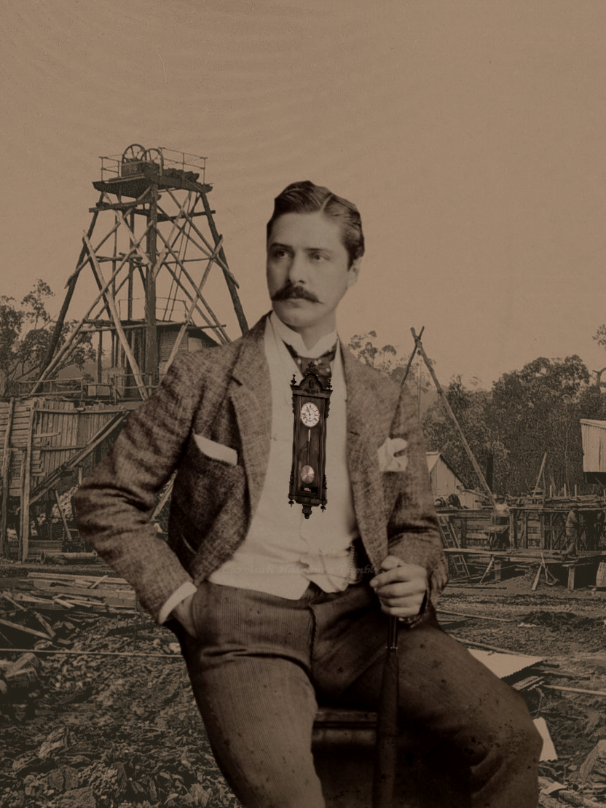

# Viktok Ág



|  Level   | Race  | Funds | Danger |
| :------: | :---: | :---: | :----: |
| `lvl 13` | Human |  4g   | `4`/2  |

<details>
<summary>Details</summary>

> `Level` is the sum of points assigned to Classes.
>
> `Danger` symbolizes the amount of source score cost of next action.

</details>

|  Source  | Score | Wound |
| :------: | :---: | :---: |
| **Tělo** | `3`/3 |       |
| **Dušě** | `5`/7 |       |
| **Vliv** | `3`/5 |       |

<details>
<summary>Details</summary>

> `Sources` are the main aspects of life
>
> `Telk`: Strength, Health, Endurance and Stamina.
>
> `Duše`: Focus, Determination, Willpower and Mental Fortitude.
>
> `Vliv`: Courage, Self-perception and Trust.

</details>

<details>
<summary>Details</summary>

> `Wounds` represent lasting injuries or traumas.

</details>

## Classes

| Base      | Level |
| --------- | :---: |
| Bojovník  |       |
| Lovec     |       |
| Zaříkávač |  `4`  |
| Kejklíř   |  `5`  |
| Mastičkář |  `3`  |

| Advanced                           | Level |
| ---------------------------------- | :---: |
| Válečník (Bojovník + Kejklíř)      |       |
| Hraničář (Bojovník + Lovec)        |       |
| Šaman (Lovec + Mastičkář)          |       |
| Druid (Lovec + Zaříkávač)          |       |
| Lupič (Kejklíř + Mastičkář)        |       |
| Zvěd (Kejklíř + Lovec)             |       |
| Vědmák (Mastičkář + Bojovník)      |       |
| Alchymista (Mastičkář + Zaříkávač) |       |
| Čaroděj (Zaříkávač + Bojovník)     |       |
| Mág (Zaříkávač + Kejklíř)          |  `1`  |

<details>
<summary>Details</summary>

> `Action check` = (2d6 + Spell Score) ≥ 9
>
> `Accurate maneur`: spend stat to add a dice (drop lowest)
>
> `Exhaust`: raise danger by 1 and lessen a failed check

</details>

### Racial Features

#### Human

| **Contacts - Styky** | `Vliv` 1 per use                      |
| -------------------- | ------------------------------------- |
| Description:         | Take advantage of a personal contact. |

### Class features

#### Zaříkávač

| **Strength of character - Síla osobnosti** | `Dušě` 1 per use            |
| ------------------------------------------ | --------------------------- |
| Description:                               | Provide care for the `Duše` |

| **Bookworm - Knihomol** | `Mind - Vliv` Passive  |
| ----------------------- | ---------------------- |
| Description:            | Proficient in learning |

| **Cunning - Bystrost** | `Soul - Dušě` Passive                                |
| ---------------------- | ---------------------------------------------------- |
| Description:           | React to actions targeted at others in the vicinity. |

#### Trickster - Kejklíř

| **Hidden Pocket - Skrytá kapsa** | `Body - Tělo` 1 per use             |
| -------------------------------- | ----------------------------------- |
| Description:                     | Hide a small object on your person. |
|                                  | (not larger than a fist)            |

| **Talent - Talent** | `Mind - Vliv` Passive                                |
| ------------------- | ---------------------------------------------------- |
| Description:        | Proficient with an item of artistic quality.         |
|                     | (Musical Instrument - Performance, Mask - Acting...) |

| **Comedian - Komediant** | `Mind - Vliv` Passive              |
| ------------------------ | ---------------------------------- |
| Description:             | Proficient in arts and performance |
|                          |                                    |

#### Mage - Mág

| **Illusion Magic - Magie iluzí** | `Soul - Dušě` 1 per use           |
| -------------------------------- | --------------------------------- |
| Description:                     | Create and detect minor illusions |
|                                  | (Visual, Auditory, Tactile)       |

## Equipment & Inventory

- **Weapons:** `None`
- **Armor:** `None`
- **Clothing:** `Suit for travel`, `Hat`
- **Adventuring Gear:** `Handwatch`, `Pocketwatch`, `Clockworker's Tools`
- **Misc:** `Nothing`

## Appearance

- **Build:** Slim, tall
- **Skin:** Pale
- **Hair:** Brown, kept well
- **Eyes:** Brown
- **Manner:** Articulate and proper
- **Distinctive Features:** Height, prideful posture
- **Attire:** Hat and formal travelling suit

### Backstory

```txt
Viktor is a smug watchmaker from a town close to Brno.
```

## Session Notes

- has pocket clock-based exploding devices

## Traits

<details><summary></summary>

### Racial (Human) Features

| Feature            | Description |
| ------------------ | ----------- |
| **Special powers** | `Contacts`  |

### Class (Spellcaster - Zaříkávač) Features

| Feature | Description                               |
| ------- | ----------------------------------------- |
| Spells  | `Bookworm`, `Gift of Creation`, `Cunning` |

### Class (Trickster - Kejklíř) Features

| Feature | Description                           |
| ------- | ------------------------------------- |
| Spells  | `Hidden Pocket`, `Talent`, `Comedian` |
|         |                                       |

### Class (Mage - Mág) Features

| Feature | Description      |
| ------- | ---------------- |
| Spells  | `Army of Ghosts` |
|         |                  |

</details>
